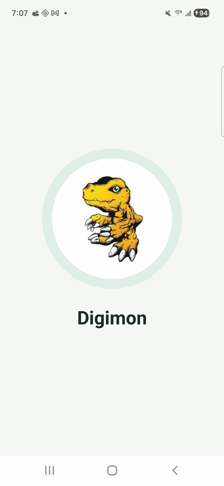
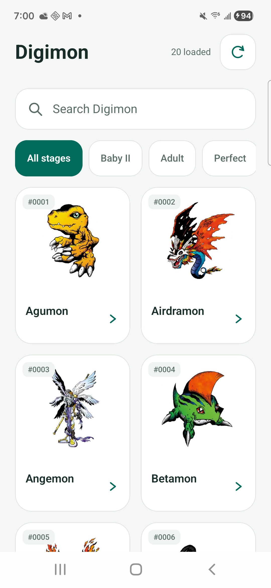
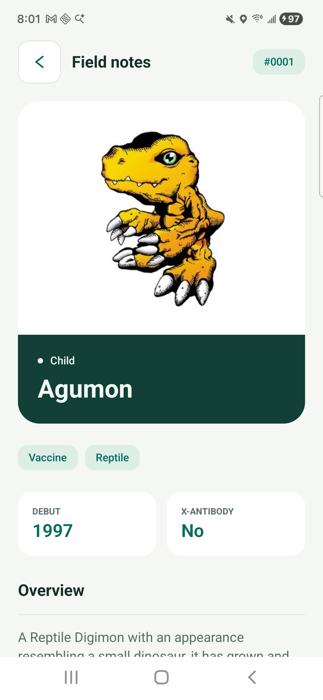
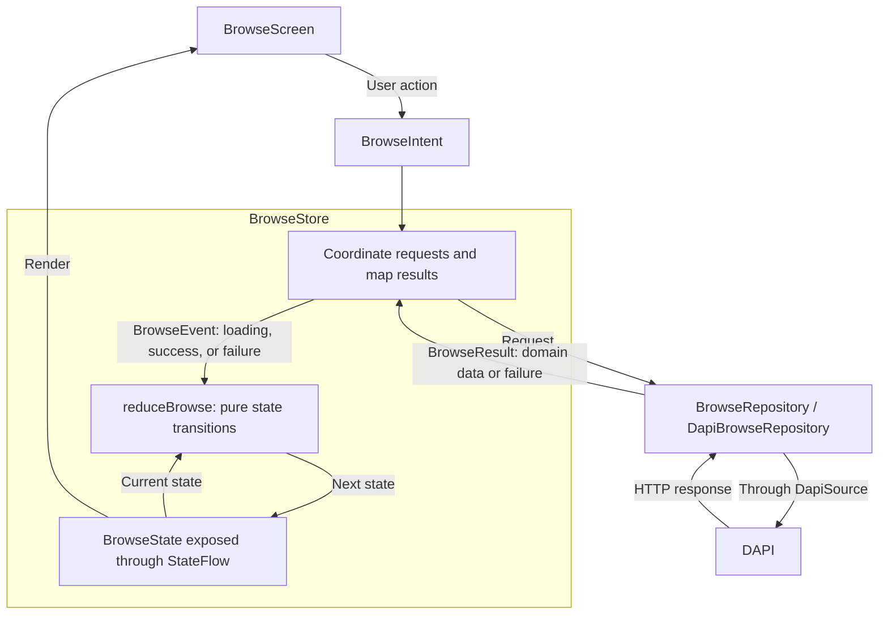

# Digimon Compose

A Digimon field guide built with Compose Multiplatform for Android and iOS. This separate edition of [the original Android app](https://github.com/GetRighhttt/DigimonAPIExample) is a place to practice MVI with shared UI, explicit state transitions, and live API data.

## Screenshots

<table>
  <tr><th>Agumon splash</th><th>Catalog</th><th>Profile</th></tr>
  <tr>
    <td></td>
    <td></td>
    <td></td>
  </tr>
</table>

Captured on a Samsung SM-G990U on October 19, 2026, using live data. The splash image is a frame from its entrance animation. System dark appearance is also implemented; these captures show the light theme.

## What works

- Browse live Digimon artwork in an adaptive grid.
- Search by name with a 300 ms debounce, filter by stage, refresh, and load more pages.
- Handle empty results, request failures, and retries separately.
- Open profiles with classification, English descriptions, debut information, X-Antibody status, expandable skills, and evolution relationship counts when available.
- Return from a profile with the query, loaded catalog, and scroll position kept.
- Show bundled Agumon artwork at launch while initial requests begin.

Browse and Profile each have a serialized MVI store and a pure reducer. Cancellation stops obsolete work; request identities reject late responses. DTOs, domain models, and presentation models are separate. Android and iOS share the screens and feature logic, with platform HTTP engines and lifecycle owners.

## MVI flow

This diagram follows Browse. Profile uses the same pattern with its own store, events, and state. `BrowseIntent` represents actions such as searching, refreshing, or loading another page.



The repository maps API data into domain models. The store maps domain results into UI values and sends events to the reducer. The reducer returns the next state; the store publishes it through `StateFlow`.

Android's `BrowseViewModel` owns the session and its stores across configuration changes. The iOS controller provides the corresponding ownership. See the [Browse walkthrough](docs/browse-mvi.md) and [architecture notes](docs/architecture.md) for the code and lifecycle details.

## Run locally

The project configures a Java 25 Gradle daemon through `gradle/gradle-daemon-jvm.properties`. Install Android SDK 37 for Android builds. Android supports API 28+, and iOS supports 16+. The iOS targets are arm64 devices and Apple Silicon simulators.

```sh
# Android debug APK
./gradlew :androidApp:assembleDebug

# Shared behavior tests, executed on the Android host
./gradlew :shared:testAndroidHostTest

# Compile shared code for the iOS simulator
./gradlew :shared:compileKotlinIosSimulatorArm64
```

For Android, open the project in Android Studio and run `androidApp`. For iOS, open `iosApp/iosApp.xcodeproj` in Xcode and run the `iosApp` scheme. Physical iOS devices require your signing team. The application identifier is `com.getrighhttt.digimoncompose`.

Format Kotlin source and build scripts with `./gradlew formatKotlin`, then check with `./gradlew checkKotlinFormatting`. The shared `.editorconfig` uses four-space indentation, a 100-character line limit, and keeps blank lines between model property groups. KDoc goes after imports and includes `@author` and `@since`.

The stack uses Kotlin, Compose Multiplatform, coroutines/StateFlow, Ktor, Kotlin serialization, and Coil. Dependency versions live in [the version catalog](gradle/libs.versions.toml). Platform hosts live in `androidApp` and `iosApp`; shared implementation and common tests live in `shared`.

## Documentation

Start with the [documentation index](docs/README.md), or go directly to:

- [Architecture and ownership](docs/architecture.md)
- [Browse MVI walkthrough](docs/browse-mvi.md)
- [Profile MVI walkthrough](docs/profile-mvi.md)
- [Live API implementation](docs/live-browse.md) and [API observations](docs/dapi-evaluation.md)
- [Design decisions and artwork source](docs/design.md)
- [Roadmap](docs/compose-multiplatform-plan.md)
- [Verification and current limits](docs/verification.md)

## Status

The last implementation checks passed 50 common tests on the Android host, the Android debug build, shared iOS simulator compilation, and the complete unsigned iOS simulator host build. The current light UI was captured on a physical Samsung. See [verification](docs/verification.md) for the scope of these checks.

Favorites, persistence, offline catalog browsing, interactive evolution navigation, localization, and full restoration after the operating system terminates the app are future work. Artwork caching does not provide offline catalog support.

Data and artwork come from [DAPI](https://digi-api.com/). Digimon names and artwork belong to their respective owners. This project is an unofficial learning application.
