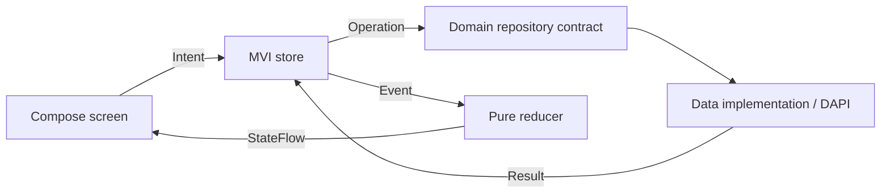

# Architecture and ownership

Android and iOS share Compose screens, MVI stores/reducers, domain contracts, data mappings, and repository implementations. Platform hosts provide the entry point, lifecycle, and HTTP engine.

## Module map

| Location | Responsibility |
| --- | --- |
| `androidApp` | Activity and retained `BrowseViewModel` |
| `iosApp` | SwiftUI host for the shared controller |
| `shared/src/commonMain` | Shared app root, features, theme, and bundled artwork |
| `shared/src/androidMain` | OkHttp engine and Android back handling |
| `shared/src/iosMain` | Darwin engine, controller, and platform adapters |
| `shared/src/commonTest` | Deterministic feature and repository tests |

Within common code, packages under `com.getrighhttt.digimoncompose` separate responsibilities:

- `presentation/browse` and `presentation/profile` contain UI models, intents, stores, pure reducers, and screens.
- `domain/browse` and `domain/profile` define repository contracts and platform-independent results/models.
- `data/browse` and `data/profile` decode and validate API data, then map it to domain models. The shared `DapiSource` currently lives under `data/browse/source` and serves both features.
- `presentation/design` contains the semantic palette, shared controls, and splash.
- `app` constructs sessions and coordinates the visible screen.

## State flow

A store processes intents and operation events through one channel loop. Its coroutine jobs perform I/O and scheduling. The reducer receives an event and previous state, then returns the next state. Composables render state and dispatch intents; they do not call repositories.

DTOs describe the remote payload. Domain models describe accepted application data. Presentation models describe what a screen renders. Mappers bridge these boundaries, so API envelopes and exceptions do not reach the UI.

## Lifetime

[BrowseSession](../shared/src/commonMain/kotlin/com/getrighhttt/digimoncompose/app/BrowseSession.kt) creates the platform engine, HTTP client, shared source, and both stores. Closing it closes both stores, the client, and its engine.

Android's ViewModel owns the session across configuration changes. The iOS controller composition remembers the session and closes it on disposal. Each store has a child job; closing a store does not cancel its injected parent scope. Screens collect state with lifecycle awareness.

[DigimonApp](../shared/src/commonMain/kotlin/com/getrighhttt/digimoncompose/app/DigimonApp.kt) owns the selected profile and saveable grid state. Browse stays alive while a profile is open. Profile selection dispatches `Open` or `Closed` to the profile store. Android handles system back; iOS has an explicit back action. This is a small shared navigation shell; interactive iOS back gestures and navigation-entry ownership remain future work.

Saveable selection/grid values and a retained Android session cover ordinary UI recreation. They do not guarantee reconstruction of loaded pages after the operating system terminates the process.
